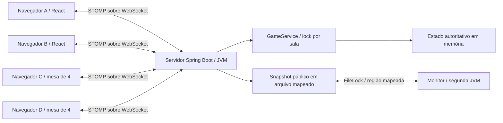

# Arquitetura

O controlador HTTP cria credenciais anônimas. SocketSecurity autentica o CONNECT e atribui Principal;
o playerId enviado pelo cliente não é aceito. GameSocketController traduz comandos em chamadas ao
GameService. O serviço cuida de salas, baralho, fases, turnos, vitória e expiração. MeldValidator
particiona as nove cartas por busca exaustiva em três combinações; não depende de interface ou Spring.

Cada Room/Player é privado ao serviço. O lock protege os campos mutáveis; DTOs são records e as listas
de snapshots são cópias imutáveis. EventDispatcher publica o espelho e as mensagens depois da liberação
do lock da sala. Atualizações concorrentes podem chegar fora de ordem ao dispatcher; versão menor é
ignorada no mmap e no frontend. Expiração e publicação são coordenadas pelo monitor do dispatcher.
Nenhum lock da sala é mantido durante rede ou force() do mmap.

React organiza pages (Home, Room, Table), components (Card, Rules), services (STOMP/credenciais),
hooks (useGame) e utils (reducer e ordenação). Não há contexto global extra porque apenas App precisa
possuir o hook. O servidor determina validade, turno, cartas e resultado. O cliente apenas apresenta,
seleciona carta e desabilita ações que o estado atual não permite.

Produção: frontend compilado é copiado pelo Maven para os recursos estáticos do JAR. Uma origem na
porta 8080 atende HTML, REST e WebSocket. Desenvolvimento: Vite na 5173 usa proxy para o mesmo backend.
Sem banco e sem necessidade de broker externo. Não há failover ou execução distribuída do servidor.
